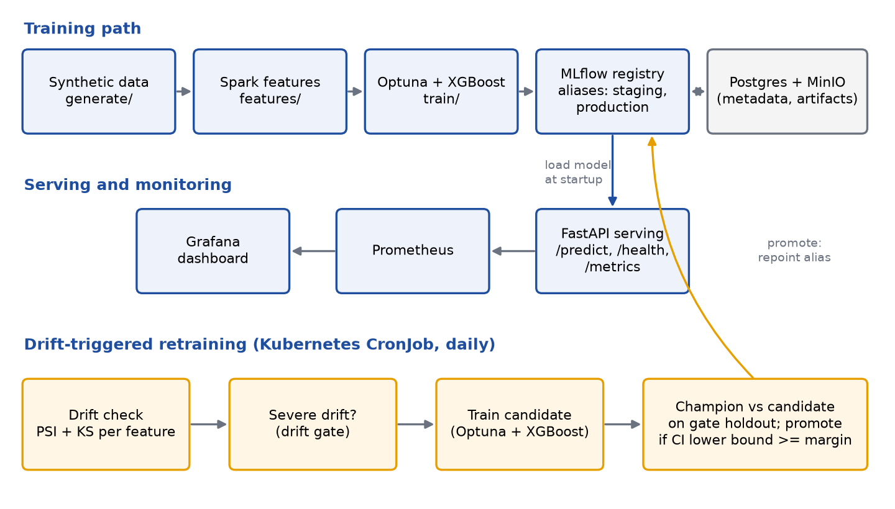
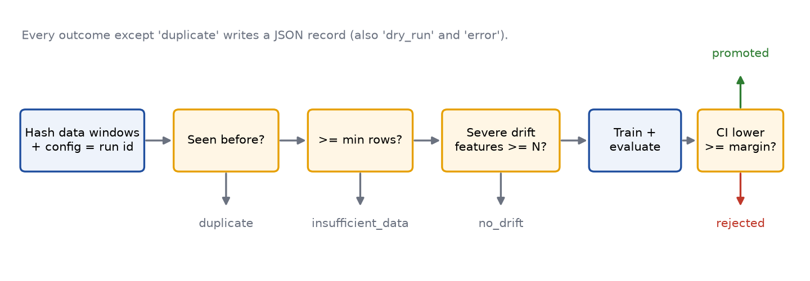
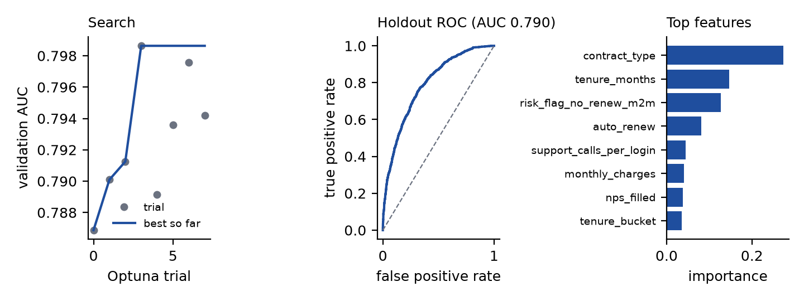
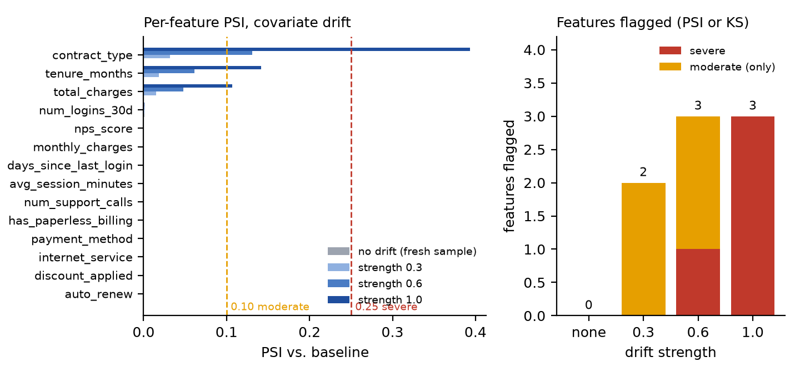

```{=typst}
#show <refs>: set par(hanging-indent: 0.5in, first-line-indent: 0pt, justify: false)
#set text(hyphenate: false)
#set bibliography(title: "References")
#show cite: set text(fill: rgb("#1f4e9e"))
#show bibliography: set par(justify: false)
// Three-rule tables (top, below header, bottom) and bold "Figure N" / "Table N" labels
#set table.hline(stroke: 0.6pt)
#show table: it => box(stroke: (top: 1pt, bottom: 1pt), it)
#show figure.caption: it => context [#strong[#it.supplement~#it.counter.display(it.numbering)#it.separator]#it.body]
#show table: set par(justify: false)
#show heading.where(level: 1): it => block(above: 1.2em, below: 0.6em)[
  #set text(fill: rgb("#1f4e9e"), size: 14pt, weight: "bold")
  #it
]
#show heading.where(level: 2): set text(fill: rgb("#2d2d2d"), size: 11.5pt)
#let glance(body) = block(fill: rgb("#eef3fb"), stroke: (left: 3pt + rgb("#1f4e9e")), inset: 10pt, radius: 2pt, width: 100%, body)
// Header: red title, subtitle, author, repository link
#align(center)[
  #set par(justify: false)
  #text(size: 17pt, weight: "bold", fill: rgb("#b91c1c"))[MLOps Churn Platform]
  #v(0.5em)
  #text(size: 12pt, weight: "bold")[From synthetic data to a drift-triggered retrain job that only promotes a model if it beats the current one]
  #v(0.9em)
  #text(size: 11pt)[Reagan Kesseku, Ph.D.]
  #linebreak()
  #text(size: 10pt)[#link("https://github.com/rkesseku/mlops-churn")[github.com/rkesseku/mlops-churn]]
  #v(0.45em)
  #text(size: 9.5pt)[#emph[Keywords:] MLOps, model registry, drift detection, automated retraining, churn prediction]
]
#v(0.5em)
```

```{=typst}
#glance[
*At a glance* \
*Problem:* A model that predicts customer churn is only useful while the customers it sees still look like the customers it was trained on. Most projects stop at a notebook. This one asks how to retrain, compare and swap a model safely when the data shifts. \
*What I built:* An end-to-end MLOps platform on synthetic data. It covers Spark feature engineering, XGBoost tuned with Optuna, an MLflow model registry, a FastAPI prediction service in Docker, Kubernetes manifests, Prometheus/Grafana monitoring, and a drift check (PSI and KS) that triggers a retrain job. The job promotes the new model only if it beats the current one on a dedicated holdout by a margin that the lower bound of a paired-bootstrap interval must clear. \
*Headline result:* On a small run I executed for this brief (30,000 synthetic customers, 8 Optuna trials), the model reached test AUC 0.790. The drift check flagged mild-to-strong input drift. A deliberately weaker candidate was rejected on the separate gate split (AUC 0.785 vs 0.800, difference −0.015, 95% CI −0.021 to −0.009), and a re-run on identical inputs was recognised as a duplicate and skipped. The test suite (100 tests) passes. \
*Stack:* Python, PySpark, XGBoost, Optuna, MLflow, FastAPI, Docker, Kubernetes (kustomize), Prometheus, Grafana, GitHub Actions. \
*Repo:* #link("https://github.com/rkesseku/mlops-churn")[github.com/rkesseku/mlops-churn]
]
```

# The problem

Companies that sell subscriptions want to know which customers are about to leave, so they can act before it happens. A churn model scores each customer with a probability of leaving. Building such a model once is the easy part. The hard part comes afterwards. Customer behaviour changes (a pricing change, a new contract mix), the model's inputs drift away from what it learned, and its predictions quietly get worse. Nobody notices until the retention team stops trusting the scores.

A production system therefore has to answer four questions that a notebook never does:

- **Which model is live right now?** (a registry with named aliases such as `staging` and `production`)
- **Has the data changed?** (statistical drift checks against the training-time data)
- **Is a retrained model actually better?** (a champion/challenger comparison on one shared holdout, backed by an interval rather than a hunch)
- **Can this happen automatically without making things worse?** (explicit gates, an audit record per decision, and safe re-runs)

This project builds those pieces and wires them together so the lifecycle can be run and tested locally. The data is synthetic by design. It is reproducible, drift can be injected on demand, and no real customer information is involved. The package has one module per stage (`generate`, `features`, `train`, `serve`, `monitor`, `retrain`), plus Docker, Prometheus/Grafana and Kubernetes configuration and a CI workflow.

# Approach

## Architecture

{#fig-arch width=80%}

## How the pieces fit together

| Stage | What it does | Where |
|---------------------|-----------------------------------------------------|--------------------------|
| Data | Generates synthetic customers (14 behavioural and billing features, an id, a timestamp and a churn label). Can inject covariate, label or concept drift at a chosen strength. | `generate/` |
| Features | PySpark job adds derived features (charge ratio, engagement score, support calls per login, a risk flag, imputed values) and makes a 60/15/10/15 train / validation / gate / test split. | `features/` |
| Training | Optuna [@akiba2019] (TPE sampler) searches XGBoost [@chen2016xgboost] hyperparameters. Every trial is logged to MLflow, and the best setting is refit on the full training set and registered. | `train/` |
| Registry | MLflow [@zaharia2018] with Postgres and MinIO. Models are referenced by alias, so promotion is just repointing a name. | `docker-compose.yml` |
| Serving | FastAPI with `/predict`, `/predict_batch`, `/health`, `/metrics` and `/drift/score`. Loads the registry model once at startup. | `serve/` |
| Monitoring | Prometheus scrapes the service and a provisioned Grafana dashboard shows it. | `prometheus/`, `grafana/` |
| Drift and retrain | PSI and KS per feature, a severity gate, training, a promotion gate, and a JSON decision record. | `monitor/`, `retrain/` |
| Deployment | Kustomize base plus a local overlay: Deployment with probes, Service, autoscaler, daily CronJob, Pushgateway. | `k8s/` |

: The stages of the platform. {#tbl-stages tbl-colwidths="[15,63,22]"}

# Design decisions and rationale

## Drift detection: two complementary tests

Each numeric feature is scored with the **Population Stability Index (PSI)** and a **two-sample Kolmogorov-Smirnov (KS) test**. Categorical and boolean features use a categorical PSI. PSI bins the baseline into deciles and measures how the new data redistributes across them. I use the common rule of thumb (below 0.10 stable, 0.10 to 0.25 moderate, above 0.25 severe) as the severity scale. KS gives a significance-aware view, and a feature is classed severe by KS only when the p-value is below 0.001 and the statistic exceeds 0.1.

## Two separate gates

The retrain loop (@fig-flow) makes two decisions, kept as pure functions (no MLflow or Spark imports) so they are unit-tested with fakes.

1. **Drift gate.** Retrain only if at least `min_severe_features` distinct features are severe (default 1). A `--force` flag bypasses it and a `--dry-run` flag stops after it.
2. **Promotion gate.** Candidate and champion are scored on the *same* gate split, a holdout used only for promotion decisions. The final test split is scored once per training run and the gate refuses to use it, so repeated decisions do not wear it out. A paired bootstrap [@efron1993] resamples the gate rows (1,000 draws by default), scoring both models on each resample, and gives a 95% interval for the improvement. The candidate is promoted only if the interval's *lower bound* clears the margin (default 0.002 AUC), so a gain within holdout noise is rejected. PR-AUC and log loss are also supported, with log loss treated as lower-is-better. If no champion exists, the candidate is promoted. Rejected versions are tagged in the registry.

{#fig-flow width=76%}

## Safe automation

- **Idempotency.** The run id is a hash of the data-window fingerprints and the decision-relevant configuration, deliberately not the champion version. Re-running on unchanged inputs returns `duplicate` without retraining, even after a promotion, and a prior `error` record is retried.
- **Audit trail.** One atomically written JSON file per run records status, drift detail, both metric values, the improvement interval, versions and configuration.

# Results

All numbers below come from code I ran for this brief at small scale (`docs/brief/run_experiments.py`, output in `results.json`). The run used 30,000 synthetic customers with a 27.4% churn rate, features built with the repository's own Spark transforms, a local SQLite-backed MLflow store in a temporary directory, and the real orchestrator and MLflow backend. Treat it as a smoke-scale demonstration rather than a benchmark.

The splits have 18,101 / 4,420 / 3,015 / 4,464 train / validation / gate / test rows, with 25 columns after feature engineering. Optuna ran 8 trials on 15,000-row subsamples. **On the test split the champion (v1) reaches AUC 0.790, PR-AUC 0.587 and log loss 0.466.** On the gate split it scores AUC 0.800.

{#fig-train width=78%}

## Drift detection

I generated fresh baseline-like data and covariate-drifted data (older customer base, fewer month-to-month contracts) at increasing strength and scored each against the training-time data. A fresh sample with no injected drift flagged nothing. At strength 1.0, `contract_type` reached PSI 0.393 (severe), while `tenure_months` and `total_charges` were severe through the KS test (statistics 0.154 and 0.141) and moderate by PSI (0.141 and 0.107).

{#fig-drift width=70%}

## Retrain decisions

I then ran the real orchestrator against that champion, using covariate drift of strength 0.8 as the "current" data.

| Scenario | Outcome | Evidence |
|-----------------------------------------|-----------|------------------------------------------------|
| No drift (fresh baseline) | `no_drift` | 0 severe features, nothing trained |
| Drift, dry run | `dry_run` | Severe: tenure and total charges. Nothing trained |
| Drift, weaker candidate, margin 0.002 | `rejected` | Gate AUC 0.785 vs 0.800, Δ −0.015 (CI −0.021, −0.009) |
| Drift, same-recipe candidate, margin 0 | `promoted` | AUC tie, CI [0, 0]. Aliases now point to v3 |
| Identical inputs re-run | `duplicate` | Skipped, original status reported |

: Retrain outcomes from the real orchestrator and MLflow backend. Promotion comparisons use the 3,015-row gate split and a 1,000-draw paired bootstrap. {#tbl-scen}

The tie in row 4 needs a careful reading. The candidate was trained on the same features as the champion, so it reproduced the same model exactly. Both models give identical scores on every gate row, so every bootstrap draw has a difference of exactly 0 and the interval is [0, 0]. With margin 0 an exact tie passes the gate (a lower bound of 0 is at least 0), which is why the production default is a small positive margin. A candidate that differs from the champion only by holdout noise would have an interval straddling zero and be rejected even if its point estimate cleared the margin. The unit tests cover that case.

# What this demonstrates

- **Lifecycle thinking.** Around the model sit registry aliases, a promotion gate, rollback via aliases and an audit record per decision.
- **Defensible automation.** Two explicit gates, a promotion margin that a paired-bootstrap lower bound must clear on a holdout kept apart from the final test set, idempotent runs and an error-retry path, with decision logic isolated from infrastructure so it can be tested with fakes.
- **Engineering hygiene.** 100 tests pass locally (including Spark tests). CI runs lint, unit tests on Python 3.10 and 3.11, a separate Spark job, and manifest validation with `kubeconform`.

# Limitations and next steps

**Limitations (stated plainly).**

- **Synthetic data only.** Results say nothing about real churn performance. My run is small (8 trials, 30,000 rows) and its AUC of 0.790 should not be read as the model's ceiling. I did not run the full-scale workflow.
- **Kubernetes is structurally tested but not deployed.** The manifests are parsed, cross-checked by tests and validated in CI, but they have not been applied to a live cluster. The README lists this as open.
- **No hot reload.** Serving loads the model at startup, so a promoted model only reaches users after a pod restart (for example `kubectl rollout restart deploy/churn-serving`).
- **Feature refresh is not bundled in the CronJob.** Spark feature generation for a new window must be supplied through `--features-cmd` or an upstream job. In my scenarios the candidate was trained on the existing features, which is why the same-recipe candidate tied.
- **Only input drift is monitored.** I also generated label drift (churn rate 27.4% to 44.1%) and concept drift (price-sensitivity change, churn rate 27.9%) at strength 0.6, and the feature-level check flagged nothing for either. Detecting those needs labelled outcomes and performance monitoring, which this project does not have.
- **Environment note.** Spark's Parquet writer needs winutils on Windows, so in my run Spark computed the features and pandas wrote the split files.

**Next steps.** I would first apply the manifests to a kind cluster and add automatic serving reload after promotion. The retrain job should also bundle the Spark feature refresh. Beyond that, delayed-label performance monitoring and a shadow or canary stage between challenger and champion would close the remaining gaps.

# How to run it


After `pip install -e ".[dev]"`: `make up`, `make data`, `make features`, `make train-quick`, `make serve` start the stack, build data and features, train and serve. `make retrain-dry-run` runs only the drift gate, and `make retrain-auto` runs the full loop. For Kubernetes, `make k8s-build k8s-load-kind k8s-apply` targets kind (not exercised here). To regenerate this brief, run `docs/brief/run_experiments.py`, then `make_figures.py`, then render `brief.qmd` with Quarto.

# References {.unnumbered}

::: {#refs}
:::
